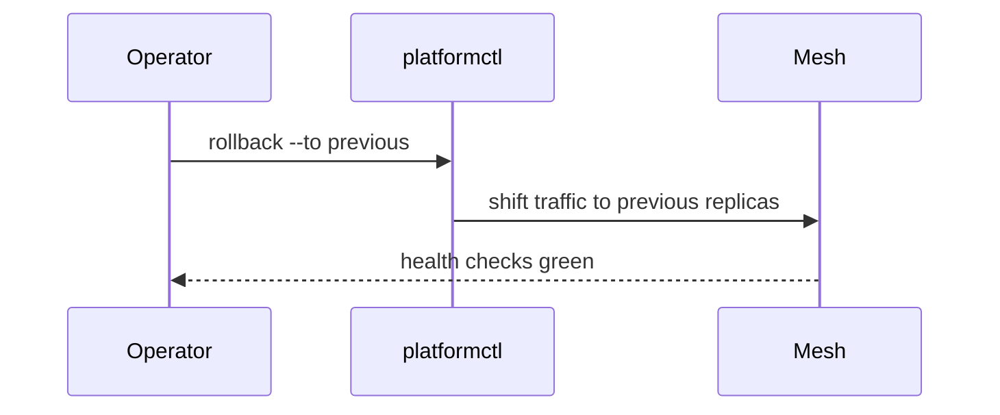

# Rolling back a deploy

A rollback returns a service to the version it ran before the last deploy. It is the first answer
to a deploy that breaks production, before anyone starts to debug the new version.

## When to roll back

Roll back as soon as a deploy causes errors that users see, or when the health checks of a service
stay red for more than five minutes after a deploy. Do not wait for the cause to be understood:
the old version is known to work, and the new one can be debugged once production is stable again.
The [caution note](../../shared/caution.md) for production changes applies to rollbacks as well.

### Who decides

The on-call engineer decides alone.

## How the rollback works

`platformctl rollback` never builds anything. It points the service mesh back at the replicas of
the previous version, which stay running for one hour after every deploy for exactly this reason.
Traffic moves over within a few seconds, and the replicas of the broken version are stopped once
the health checks of the previous version are green again.

## Rolling back step by step

Start by telling the team. Post in the `#platform-ops` channel which service you are rolling back,
which version is broken and which version you are returning to, so nobody deploys on top of your
rollback or starts a second one in parallel. If an incident is open, link the message there too, so
the timeline of the incident shows when the rollback began and who carried it out.

Check that the previous version is still available before you start. The replicas of the previous
version are kept for one hour after a deploy; `platformctl status --service <name>` lists them
under `standby`. If the list is empty, the hour has passed, and a rollback means deploying the
previous version again with `platformctl deploy --version <previous>`, which takes as long as any
other deploy and follows the deploy checklist instead of this runbook.

Run the rollback with `platformctl rollback --service <name> --to previous`. The command asks for
confirmation, shows the version it is about to return to and then shifts the traffic. Keep the
terminal open until it reports that the health checks are green; closing it does not stop the
rollback, but you lose the progress output that tells you whether the traffic shift completed.

Watch the error rate of the service for ten minutes after the command finished. The dashboards
of the service show the rate per replica, and the rate of the previous version should return to
what it was before the deploy. If it does not, the deploy was not the cause of the errors, and the
incident needs a different answer than a rollback; tell the team in the channel right away so the
investigation does not stop at the wrong conclusion.

Write down what happened while it is fresh. The incident record needs the time of the deploy, the
time the errors started, the time of the rollback and the version numbers involved. These four
values are what the review of the incident starts from, and they are hard to reconstruct a week
later from logs alone, because the logs of the stopped replicas are deleted after three days.

Finally, block the broken version from being deployed again by marking it with
`platformctl release block --version <broken>`. A blocked version cannot be deployed until someone
unblocks it with a reason, which keeps an automated pipeline or a colleague who missed the message
from putting the broken version back into production while the cause is still being investigated.

Check the dependent services next. A rollback of `auth-service` can leave services that cached
tokens from the broken version with tokens the previous version does not accept; their replicas
log `token rejected` and recover only when the cache expires. Restart the replicas of every
service that logs this message with `platformctl restart --service <name>` instead of waiting for
the cache, which can take up to an hour and keeps the incident open for no reason.

Hand over before you leave. If your shift ends while the incident is still open, tell the next
on-call engineer which version is running, which version is blocked and which checks are still
outstanding. Write the same in the incident record, so the handover does not depend on a message
in a channel that scrolls away during a busy morning.

Close your part of the rollback with a short summary in the `#platform-ops` channel: the service,
the versions, the time production was stable again and the link to the incident record. The team
that owns the service picks the investigation up from there, and the summary is the message they
start from when they plan the fixed release.

## After a rollback

The team that owns the service investigates the broken version and fixes it in a new release. The
rolled back version is never deployed again unchanged, even if the cause turns out to be outside of
it. Close the incident only when the new release has been deployed and watched for a full day.
